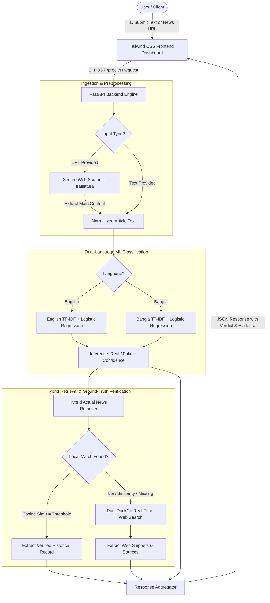
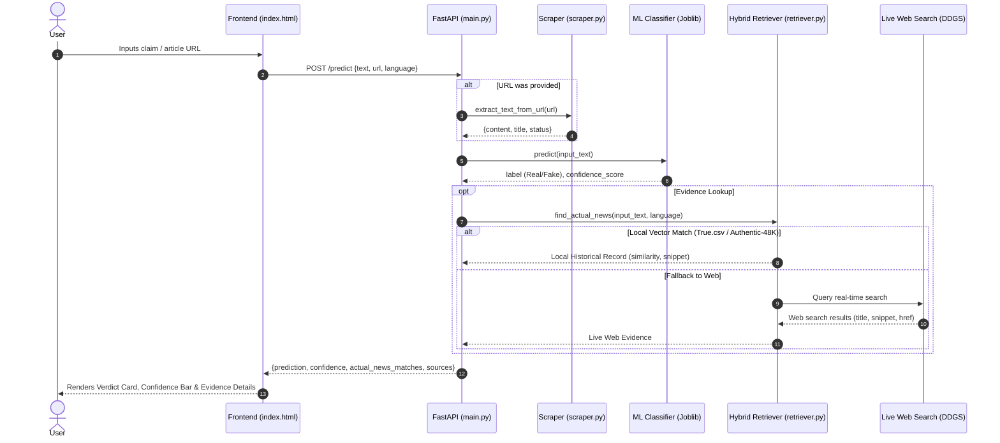

# 🛡️ VeriFact AI — Bilingual Fake News Detection & Fact Verification Platform

[](https://www.python.org/)
[](https://fastapi.tiangolo.com/)
[](https://scikit-learn.org/)
[](LICENSE)

An enterprise-grade, full-stack bilingual (**English & Bangla**) misinformation detection and fact-verification platform. **VeriFact AI** unites dual-language Machine Learning classification pipelines with a large-scale hybrid retrieval engine (indexing 70,000+ verified historical articles alongside live web search fallback) and server-side article scraping to deliver real-time news authenticity assessments.

---

## 📑 Table of Contents

- [Key Features](#-key-features)
- [System Architecture & Design](#-system-architecture--design)
  - [High-Level Architectural Flow](#high-level-architectural-flow)
  - [Verification Sequence Diagram](#verification-sequence-diagram)
- [Project Directory Structure](#-project-directory-structure)
- [Modules & Codebase Breakdown](#-modules--codebase-breakdown)
- [Installation & Setup Guide](#-installation--setup-guide)
- [Dataset Preparation](#-dataset-preparation)
- [Model Training Pipeline](#-model-training-pipeline)
- [Running the Application](#-running-the-application)
- [API Reference & Usage](#-api-reference--usage)
- [Frontend Dashboard](#-frontend-dashboard)
- [Team Collaboration & Contributing](#-team-collaboration--contributing)

---

## 🚀 Key Features

* **Dual-Language ML Classification:** Dedicated, specialized NLP pipelines for English and Bangla. Incorporates Unicode character preservation and class-weight balancing for accurate detection across asymmetric datasets.
* **Hybrid Fact-Verification Engine:** Cross-references incoming claims against over 70,000 verified authentic historical articles (21,417 English and 48,678 Bangla records).
* **Real-Time Live Web Search Fallback:** When local historical similarity is inconclusive or absent, the platform automatically queries real-time regional web sources via DuckDuckGo Search.
* **Secure Server-Side Article Scraper:** Extracts clean article body text, titles, and publication metadata directly from news URLs using `trafilatura` with integrated SSRF (Server-Side Request Forgery) protection.
* **Modern Responsive Dashboard:** Modern glassmorphism UI built with Tailwind CSS, featuring instantaneous API status monitoring, text and URL input modes, confidence bars, and detailed evidence cards.
* **Production-Ready REST API:** Asynchronous FastAPI backend equipped with CORS, Pydantic data validation, modular error handling, and interactive OpenAPI documentation (`/docs`).

---

## 🏛️ System Architecture & Design

### High-Level Architectural Flow



### Verification Sequence Diagram



---

## 📁 Project Directory Structure

```text
Fake_News_Detection/
├── data/                         # Local dataset directory (gitignored)
│   └── README.md                 # Dataset instructions & download guide
├── .gitignore                    # Git ignore rules for environments, datasets & models
├── check.py                      # System diagnostics and environment checker script
├── index.html                    # Responsive bilingual Tailwind CSS frontend dashboard
├── main.py                       # FastAPI application, REST endpoints, and router logic
├── README.md                     # Comprehensive project documentation
├── requirements.txt              # Standardized Python package dependencies
├── retriever.py                  # Hybrid Actual News Retriever (TF-IDF + DuckDuckGo)
├── scraper.py                    # Trafilatura web scraper with SSRF protection
├── train.py                      # English ML model training & evaluation pipeline
└── train_bn.py                   # Bangla ML model training & evaluation pipeline
```

---

## 🔍 Modules & Codebase Breakdown

| File | Primary Responsibility | Key Functions / Classes |
|---|---|---|
| **`main.py`** | FastAPI application entry point, CORS middleware, inference orchestration, and response assembly. | `predict_news()`, `root()`, `health_check()` |
| **`retriever.py`** | Multi-tier evidence retrieval. Performs local vector similarity indexing over 70k+ authentic articles, falling back to live search. | `ActualNewsRetriever`, `find_actual_news()`, `clean_query_text()` |
| **`scraper.py`** | Robust web content scraper powered by `trafilatura`. Strips boilerplates and guards against SSRF attacks. | `extract_text_from_url()`, `is_safe_url()` |
| **`train.py`** | Training pipeline for English news detection. Combines `True.csv` and `Fake.csv` with TF-IDF + Logistic Regression. | `train_model()`, `resolve_data_dir()` |
| **`train_bn.py`** | Training pipeline for Bangla news detection using BanFakeNews (`Authentic-48K` and `Fake-1K`). Uses custom Unicode token regex and class-weight balancing. | `train_bangla_model()`, `resolve_data_dir()` |
| **`check.py`** | Diagnostic script verifying dataset placement, model artifacts, and library readiness. | `check_system()` |
| **`index.html`** | Single-page responsive application with real-time backend status checking, language toggle, and evidence display. | `initDashboard()`, `verifyNews()`, `renderResults()` |

---

## 🛠️ Installation & Setup Guide

### 1. Clone the Repository
```bash
git clone https://github.com/nazerindisha/Fake_News_Detection.git
cd Fake_News_Detection
```

### 2. Create and Activate Virtual Environment
```bash
# Windows (PowerShell)
python -m venv venv
.\venv\Scripts\Activate.ps1

# Linux / macOS
python3 -m venv venv
source venv/bin/activate
```

### 3. Install Dependencies
```bash
pip install --upgrade pip
pip install -r requirements.txt
```

### 4. Run System Diagnostics
```bash
python check.py
```

---

## 📦 Dataset Preparation

Place the following CSV files in the `data/` directory (or set the `DATA_DIR` environment variable):

1. **English Datasets (ISOT Fake News Dataset):**
   * `True.csv` — 21,417 authentic news articles.
   * `Fake.csv` — 23,481 flagged misinformation articles.
2. **Bangla Datasets (BanFakeNews Dataset):**
   * `Authentic-48K.csv` — 48,678 authentic Bangla news articles.
   * `Fake-1K.csv` — ~1,300 verified misinformation articles.

---

## 🧠 Model Training Pipeline

Once the datasets are placed in `data/`, run the training scripts to generate model artifacts (`.joblib` files):

### Train the English Model
```bash
python train.py
```
* Generates `fake_news_model.joblib`.
* Evaluates accuracy, precision, recall, F1-score, and confusion matrix on test split.

### Train the Bangla Model
```bash
python train_bn.py
```
* Generates `fake_news_model_bn.joblib`.
* Uses `token_pattern=r'[\u0980-\u09FF\w]+'` to preserve Bengali conjuncts and vowel marks (kar/fala).
* Utilizes `class_weight='balanced'` to offset the ~48:1 class imbalance.

---

## 🌐 Running the Application

### 1. Launch the FastAPI Backend
```bash
uvicorn main:app --host 127.0.0.1 --port 8000 --reload
```
* **API Home:** `http://127.0.0.1:8000/`
* **Interactive Swagger UI:** `http://127.0.0.1:8000/docs`
* **Health Endpoint:** `http://127.0.0.1:8000/health`

### 2. Launch the Frontend Dashboard
Simply open `index.html` in any modern web browser, or serve it using a lightweight local web server:
```bash
# Using Python's built-in HTTP server
python -m http.server 3000
```
Then visit `http://localhost:3000` in your browser.

---

## 📡 API Reference & Usage

### Endpoint: `/predict` [POST]

Verify a text claim or extract and check a news URL.

#### Request Schema (JSON)
```json
{
  "text": "NASA confirms water ice discovery near the lunar south pole.",
  "url": null,
  "language": "en"
}
```

#### Example cURL Request (Text Input)
```bash
curl -X POST "http://127.0.0.1:8000/predict" \
     -H "Content-Type: application/json" \
     -d '{
       "text": "বাংলাদেশ ব্যাংক নতুন মুদ্রানীতি ঘোষণা করেছে।",
       "language": "bn"
     }'
```

#### Example cURL Request (URL Input)
```bash
curl -X POST "http://127.0.0.1:8000/predict" \
     -H "Content-Type: application/json" \
     -d '{
       "url": "https://www.bbc.com/news/articles/c04901g7x9vo",
       "language": "en"
     }'
```

#### Example Successful Response
```json
{
  "language": "English",
  "language_code": "en",
  "prediction": "Real",
  "confidence": 94.62,
  "actual_news_matches": [
    {
      "source_type": "local_historical",
      "source_label": "Verified Local Database (True.csv)",
      "title": "NASA announces new discoveries from lunar exploration program",
      "subject": "politicsNews",
      "date": "Verified Archive",
      "similarity_score": 0.4285,
      "snippet": "WASHINGTON (Reuters) - Scientists working on NASA's lunar initiative confirmed new evidence...",
      "url": null
    }
  ],
  "evidence": "[Verified Local Database (True.csv)] NASA announces new discoveries...",
  "sources": [],
  "input_preview": "NASA confirms water ice discovery near the lunar south pole.",
  "note": null
}
```

---

## 💻 Frontend Dashboard

The frontend interface (`index.html`) includes:
* **Interactive Mode Switcher:** Easily toggle between direct text/claim input and live news URL submission.
* **Instant Language Toggle:** Seamless switching between English and Bangla input with language-appropriate sample prompts.
* **Dynamic Server Status Indicator:** Live ping checking `/` endpoint with automatic status badge (`API Online` / `API Offline`).
* **Visual Verdict & Confidence Bar:** Real-time color transitions (Green for Real, Red for Fake, Amber for Unverified) with smooth animation.
* **Detailed Evidence Display:** Shows title, snippet, source badge, similarity score, and direct outbound links for verified ground-truth articles.

---

## 👥 Team Collaboration & Contributing

This project is maintained as a collaborative team initiative.

### Contribution Workflow
1. **Fork or Branch:** Create a feature branch (`git checkout -b feature/improved-bangla-tokenization`).
2. **Implement Changes:** Write modular, typed code adhering to PEP 8 standards.
3. **Verify Integrity:** Run `python check.py` to confirm environments and components.
4. **Commit & Push:** Submit clear, descriptive commit messages.
5. **Pull Request:** Open a PR describing enhancements, benchmark results, and testing steps.

---

## 📄 License
This project is open-source and available under the [MIT License](LICENSE).
