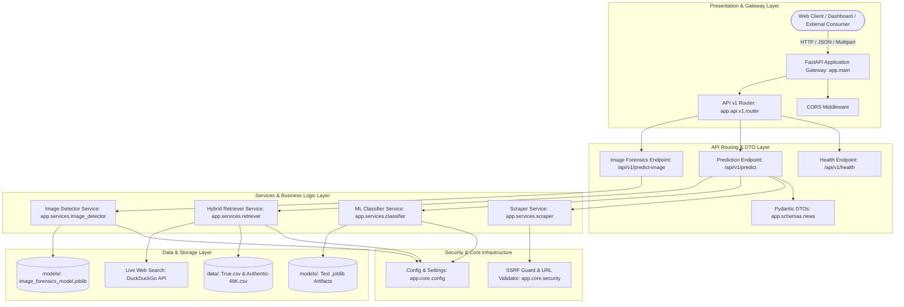

# 🛡️ VeriFact AI — Enterprise Bilingual Fake News Detection & Image Forensics Platform

[](https://www.python.org/)
[](https://fastapi.tiangolo.com/)
[](https://scikit-learn.org/)
[]()
[](LICENSE)

An industrial-grade, modular, full-stack bilingual (**English & Bangla**) misinformation detection, multimodal image forensics, and retrieval-augmented fact verification platform. **VeriFact AI** utilizes a decoupled, enterprise layered architecture with dedicated API routing, validation schemas, ML classification pipelines, ELA (Error Level Analysis) image manipulation detection, hybrid ground-truth retrieval (70,000+ authentic articles + live DuckDuckGo web search fallback), and server-side scraping with SSRF protection.

---

## 📑 Table of Contents

- [System Architecture & Layered Design](#-system-architecture--layered-design)
  - [Modular Component Architecture](#modular-component-architecture)
  - [End-to-End Verification Flow](#end-to-end-verification-flow)
- [Enterprise Directory Structure](#-enterprise-directory-structure)
- [Key Platform Capabilities](#-key-platform-capabilities)
  - [1. Bilingual Text Classification & Linguistic Explainability](#1-bilingual-text-classification--linguistic-explainability)
  - [2. Image Forensics & Manipulation Detection (ELA)](#2-image-forensics--manipulation-detection-ela)
  - [3. Hybrid Ground-Truth Retrieval](#3-hybrid-ground-truth-retrieval)
  - [4. Secure Server-Side Web Scraping](#4-secure-server-side-web-scraping)
- [Installation & Environment Setup](#-installation--environment-setup)
- [Dataset Preparation](#-dataset-preparation)
- [Training ML Pipelines](#-training-ml-pipelines)
- [Running the Platform](#-running-the-platform)
- [REST API Reference & Payloads](#-rest-api-reference--payloads)
- [Testing & Quality Verification](#-testing--quality-verification)
- [Team Collaboration & Contributing](#-team-collaboration--contributing)

---

## 🏛️ System Architecture & Layered Design

The codebase adheres to **Domain-Driven Modular Design** principles, ensuring clear separation of concerns between HTTP transport, request validation, business logic, machine learning pipelines, and dataset ingestion.

### Modular Component Architecture



---

## 📁 Enterprise Directory Structure

```text
Fake_News_Detection/
│
├── app/                                 # Main Application Core Package
│   ├── __init__.py                      # Package initialization and metadata
│   ├── main.py                          # FastAPI application factory & router mounting
│   │
│   ├── api/                             # API Transport Layer
│   │   └── v1/                          # Version 1 API Specification
│   │       ├── router.py                # Aggregates endpoints under /api/v1
│   │       └── endpoints/
│   │           ├── prediction.py        # POST /api/v1/predict (Text / Claim Verification)
│   │           ├── image_prediction.py  # POST /api/v1/predict-image (ELA Forensics)
│   │           └── health.py            # GET /api/v1/health
│   │
│   ├── core/                            # Cross-Cutting Infrastructure
│   │   ├── config.py                    # Environment settings, constants & paths
│   │   └── security.py                  # SSRF prevention & URL sanitization
│   │
│   ├── schemas/                         # Data Transfer Objects (DTOs)
│   │   └── news.py                      # Pydantic models (NewsRequest, PredictResponse, etc.)
│   │
│   └── services/                        # Isolated Business & ML Logic
│       ├── classifier.py                # Dual ML model inference & explainability
│       ├── image_detector.py            # ELA extraction & ML image forensics
│       ├── retriever.py                 # 70k+ vector retriever + DuckDuckGo fallback
│       └── scraper.py                   # Trafilatura web article extractor
│
├── frontend/                            # Web Client Application
│   └── index.html                       # Responsive Tailwind CSS dashboard (Text, URL & Image)
│
├── pipelines/                           # Data Science & Training Pipelines
│   ├── train_en.py                      # English dataset training (TF-IDF + Logistic Regression)
│   ├── train_bn.py                      # Bangla dataset training (Hybrid Word+Char FeatureUnion)
│   ├── evaluate.py                      # Benchmark validation & evaluation metrics
│   └── test_ela.py                      # ELA image test script
│
├── scripts/                             # Utility & Automation Scripts
│   ├── check_system.py                  # Comprehensive system diagnostic tool
│   ├── run_server.py                    # Server startup script
│   ├── collect_ela_dataset.py           # Image forensics dataset builder
│   └── train_image_model.py             # Image classifier training script
│
├── tests/                               # Automated Test Suite
│   ├── test_security.py                 # SSRF filter & URL validation tests
│   ├── test_schemas.py                  # Pydantic request/response schema tests
│   └── test_image_detector.py           # ELA image feature extraction tests
│
├── data/                                # Datasets Directory (Gitignored)
│   └── README.md                        # Dataset placement instructions
│
├── models/                              # Trained Model Weights
│   └── .gitkeep                         # Preserves directory structure in git
│
├── samples/                             # Sample images for testing ELA forensics
├── image_forensics_model.joblib         # Trained ELA image classification model
├── .env.example                         # Example environment variables
├── .gitignore                           # Excludes large binaries, CSVs, and venvs
├── check.py                             # Root wrapper for scripts.check_system
├── index.html                           # Root dashboard (synced with frontend/index.html)
├── main.py                              # Root backward-compatible FastAPI entrypoint
├── requirements.txt                     # Pinned, tested production dependencies
├── retriever.py                         # Root backward-compatible retriever wrapper
├── run.py                               # Top-level executable: python run.py
├── scraper.py                           # Root backward-compatible scraper wrapper
├── test_ela.py                          # Root ELA test wrapper
├── train.py                             # Root backward-compatible English training wrapper
└── train_bn.py                          # Root backward-compatible Bangla training wrapper
```

---

## 🔬 Key Platform Capabilities

### 1. Bilingual Text Classification & Linguistic Explainability
* **English Pipeline:** Trained on the ISOT dataset utilizing TF-IDF n-grams (1, 2) and Logistic Regression.
* **Bangla Pipeline:** Enhanced Hybrid Word+Char `FeatureUnion` on BanFakeNews dataset combining word tokens (`[\u0980-\u09FF\w]+`) and character n-grams (3 to 5) with balanced class weights.
* **Pattern Explainability:** Automatically analyzes sensationalist punctuation (`!`, `??`), ALL-CAPS emphasis, clickbait phrasing (`breaking`, `exposed`, `ভাইরাল`, `ফাঁস`), and extracts influential model feature indicators.

### 2. Image Forensics & Manipulation Detection (ELA)
* **Error Level Analysis (ELA):** Re-compresses images in memory at a controlled JPEG quality (90) and computes pixel-wise compression divergence.
* **Forensic Feature Extraction:** Evaluates `ela_mean`, `ela_std`, `ela_max`, and `high_error_ratio` ($\ge 25.0$).
* **Dual Inference Modes:** Predicts through a trained Logistic Regression pipeline with heuristic baseline fallback.

### 3. Hybrid Ground-Truth Retrieval
* **Local Verified Archive:** Indexes 70,000+ authentic records (21k English in `True.csv` and 48k Bangla in `Authentic-48K.csv`) with disk-cached TF-IDF matrices for instant server boots.
* **Live Search Fallback:** When local similarity falls below threshold, automatically queries DuckDuckGo (`bn-bd` for Bangla, `wt-wt` for English) for real-time web verification.

### 4. Secure Server-Side Web Scraping
* Uses `trafilatura` to extract article body text, headline, author, and date.
* Built-in **SSRF Protection** blocks private, loopback, and cloud metadata IPs (`127.0.0.1`, `10.0.0.0/8`, `169.254.169.254`).

---

## 🛠️ Installation & Environment Setup

### 1. Clone the Repository
```bash
git clone https://github.com/nazerindisha/Fake_News_Detection.git
cd Fake_News_Detection
```

### 2. Configure Virtual Environment
```bash
# Windows (PowerShell)
python -m venv venv
.\venv\Scripts\Activate.ps1

# Linux / macOS
python3 -m venv venv
source venv/bin/activate
```

### 3. Install Dependencies
```bash
pip install --upgrade pip
pip install -r requirements.txt
```

### 4. Run System Diagnostics
```bash
python check.py
```

---

## 📦 Dataset Preparation

Place the dataset CSV files inside the `data/` directory:

| Dataset File | Language | Records | Description |
|---|---|---|---|
| **`True.csv`** | English | 21,417 | ISOT Dataset (Reuters verified authentic news) |
| **`Fake.csv`** | English | 23,481 | ISOT Dataset (Misinformation and false claims) |
| **`Authentic-48K.csv`** | Bangla | 48,678 | BanFakeNews Dataset (Authentic mainstream media) |
| **`Fake-1K.csv`** | Bangla | ~1,300 | BanFakeNews Dataset (Fact-checked false reports) |

---

## 🧠 Training ML Pipelines

```bash
# Train English Pipeline
python pipelines/train_en.py

# Train Enhanced Bangla Pipeline (Word+Char FeatureUnion)
python pipelines/train_bn.py

# Train Image Forensics Model (if collecting ELA dataset)
python scripts/train_image_model.py
```

---

## 🚀 Running the Platform

### Start the Backend Server
```bash
python run.py
```
*(Alternative: `uvicorn main:app --reload`)*

* **API Home:** `http://127.0.0.1:8000/`
* **Interactive Swagger UI:** `http://127.0.0.1:8000/docs`
* **Health Check:** `http://127.0.0.1:8000/health`

### Launch the Frontend Dashboard
Simply open `index.html` (or `frontend/index.html`) in your browser, or serve it:
```bash
python -m http.server 3000
```
Visit `http://localhost:3000` to access Text, URL, and Image Forensics modes.

---

## 📡 REST API Reference & Payloads

### 1. News Verification: `POST /predict` (or `/api/v1/predict`)
```json
{
  "text": "NASA confirms new water ice deposits discovered on the Moon.",
  "language": "en"
}
```

#### Example Response:
```json
{
  "language": "English",
  "language_code": "en",
  "prediction": "Real",
  "confidence": 96.42,
  "explanations": [
    "Key model indicators — Fake signals: [uncovered, conspiracy] | Authentic signals: [nasa, scientists, reuters]"
  ],
  "actual_news_matches": [
    {
      "source_type": "local_historical",
      "source_label": "Verified Archive (True.csv)",
      "title": "NASA announces new discoveries from lunar exploration program",
      "subject": "politicsNews",
      "date": "Historical Archive",
      "similarity_score": 0.4582,
      "snippet": "WASHINGTON (Reuters) - Scientists working on NASA's lunar exploration initiative...",
      "url": null
    }
  ]
}
```

### 2. Image Forensics: `POST /predict-image` (or `/api/v1/predict-image`)
Multipart form upload with field `file` (`JPEG`, `PNG`, `WebP`).

#### Example Response:
```json
{
  "verdict": "POTENTIALLY EDITED",
  "mode": "ml_logistic_regression",
  "confidence": 88.5,
  "features": {
    "format": "JPEG",
    "width": 1200,
    "height": 800,
    "quality": 90,
    "ela_mean": 4.125,
    "ela_std": 8.642,
    "ela_max": 142.0,
    "high_error_ratio": 0.0542
  },
  "note": "Classified using trained ELA LogisticRegression pipeline."
}
```

---

## 🧪 Testing & Quality Verification

Run the automated test suite:
```bash
python -m unittest discover tests
```

---

## 👥 Team Collaboration & Contributing

1. **Branch Workflow:** Create a feature branch (`git checkout -b feature/name`).
2. **Layered Structure:** Add endpoints to `app/api/v1/endpoints/`, DTOs to `app/schemas/`, and business services to `app/services/`.
3. **Execute Diagnostics:** Verify with `python check.py` before submitting a Pull Request.

---

## 📄 License
This platform is open-source and distributed under the [MIT License](LICENSE).
