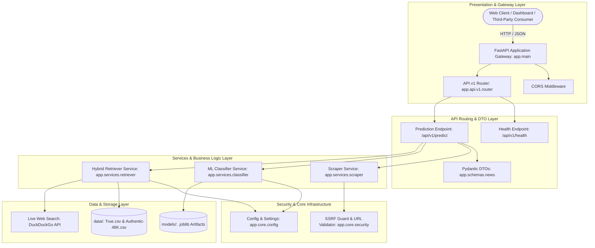
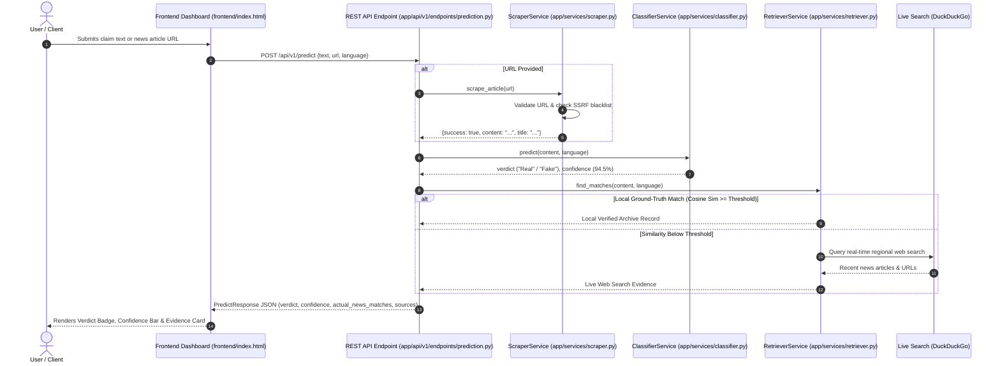

# 🛡️ VeriFact AI — Enterprise Bilingual Fake News Detection & Fact Verification Platform

[](https://www.python.org/)
[](https://fastapi.tiangolo.com/)
[](https://scikit-learn.org/)
[]()
[](LICENSE)

An industrial-grade, modular, full-stack bilingual (**English & Bangla**) misinformation detection and retrieval-augmented fact verification platform. **VeriFact AI** utilizes a decoupled, enterprise layered architecture with dedicated API routing, validation schemas, ML classification pipelines, hybrid ground-truth retrieval (indexing 70,000+ authentic articles + live DuckDuckGo web search fallback), and server-side scraping with SSRF security.

---

## 📑 Table of Contents

- [System Architecture & Layered Design](#-system-architecture--layered-design)
  - [Modular Component Architecture](#modular-component-architecture)
  - [End-to-End Verification Flow](#end-to-end-verification-flow)
- [Enterprise Directory Structure](#-enterprise-directory-structure)
- [Layer-by-Layer Technical Breakdown](#-layer-by-layer-technical-breakdown)
  - [1. Application Core (`app/core/`)](#1-application-core-appcore)
  - [2. Validation Schemas (`app/schemas/`)](#2-validation-schemas-appschemas)
  - [3. Business & ML Services (`app/services/`)](#3-business--ml-services-appservices)
  - [4. API Routing Layer (`app/api/v1/`)](#4-api-routing-layer-appapiv1)
  - [5. ML Pipelines (`pipelines/`)](#5-ml-pipelines-pipelines)
  - [6. Diagnostics & Scripts (`scripts/`)](#6-diagnostics--scripts-scripts)
  - [7. Automated Test Suite (`tests/`)](#7-automated-test-suite-tests)
- [Installation & Environment Setup](#-installation--environment-setup)
- [Dataset Preparation](#-dataset-preparation)
- [Training & Evaluating ML Models](#-training--evaluating-ml-models)
- [Running the Platform](#-running-the-platform)
- [REST API Reference & Payloads](#-rest-api-reference--payloads)
- [Backward Compatibility Layer](#-backward-compatibility-layer)
- [Security & Defense Specifications](#-security--defense-specifications)
- [Team Collaboration & Contributing](#-team-collaboration--contributing)

---

## 🏛️ System Architecture & Layered Design

The codebase adheres to **Domain-Driven Modular Design** principles, ensuring separation of concerns between HTTP transport, request validation, business logic, machine learning pipelines, and dataset ingestion.

### Modular Component Architecture



### End-to-End Verification Flow



---

## 📁 Enterprise Directory Structure

```text
Fake_News_Detection/
│
├── app/                                 # Main Application Core Package
│   ├── __init__.py                      # Package initialization and metadata
│   ├── main.py                          # FastAPI application factory & router mounting
│   │
│   ├── api/                             # API Transport Layer
│   │   ├── __init__.py
│   │   └── v1/                          # Version 1 API Specification
│   │       ├── __init__.py
│   │       ├── router.py                # Aggregates endpoints under /api/v1
│   │       └── endpoints/
│   │           ├── __init__.py
│   │           ├── prediction.py        # POST /api/v1/predict
│   │           └── health.py            # GET /api/v1/health
│   │
│   ├── core/                            # Cross-Cutting Infrastructure
│   │   ├── __init__.py
│   │   ├── config.py                    # Environment settings, constants & paths
│   │   └── security.py                  # SSRF prevention & URL sanitization
│   │
│   ├── schemas/                         # Data Transfer Objects (DTOs)
│   │   ├── __init__.py
│   │   └── news.py                      # Pydantic models (NewsRequest, PredictResponse, etc.)
│   │
│   └── services/                        # Isolated Business & ML Logic
│       ├── __init__.py
│       ├── classifier.py                # Dual ML model inference manager
│       ├── retriever.py                 # 70k+ vector retriever + DuckDuckGo fallback
│       └── scraper.py                   # Trafilatura web article extractor
│
├── frontend/                            # Web Client Application
│   └── index.html                       # Responsive Tailwind CSS dashboard
│
├── pipelines/                           # Data Science & Training Pipelines
│   ├── __init__.py
│   ├── train_en.py                      # English dataset training (TF-IDF + Logistic Regression)
│   ├── train_bn.py                      # Bangla dataset training (Unicode Regex + Balanced Weights)
│   └── evaluate.py                      # Benchmark validation & evaluation metrics
│
├── scripts/                             # Utility & Automation Scripts
│   ├── check_system.py                  # Comprehensive system diagnostic tool
│   └── run_server.py                    # Server startup script
│
├── tests/                               # Automated Test Suite
│   ├── __init__.py
│   ├── test_security.py                 # SSRF filter & URL validation tests
│   └── test_schemas.py                  # Pydantic request/response schema tests
│
├── data/                                # Datasets Directory (Gitignored)
│   └── README.md                        # Dataset placement instructions
│
├── models/                              # Trained Model Weights (Gitignored)
│   └── .gitkeep                         # Preserves directory structure in git
│
├── .env.example                         # Example environment variables
├── .gitignore                           # Excludes large binaries, CSVs, and venvs
├── check.py                             # Root wrapper for scripts.check_system
├── index.html                           # Root dashboard alias
├── main.py                              # Root backward-compatible FastAPI entrypoint
├── requirements.txt                     # Pinned, tested production dependencies
├── retriever.py                         # Root backward-compatible retriever wrapper
├── run.py                               # Top-level executable: python run.py
├── scraper.py                           # Root backward-compatible scraper wrapper
├── train.py                             # Root backward-compatible English training wrapper
└── train_bn.py                          # Root backward-compatible Bangla training wrapper
```

---

## 🔬 Layer-by-Layer Technical Breakdown

### 1. Application Core (`app/core/`)
* **`config.py`**: Centralizes configuration using strongly-typed defaults and environment variable overrides (`DATA_DIR`, `MODELS_DIR`, `HOST`, `PORT`, `CORS_ORIGINS`). Resolves paths dynamically across operating systems.
* **`security.py`**: Implements defense-in-depth URL sanitization. Validates protocol schemes (`http`, `https`), prevents SSRF attempts against `localhost`, `127.0.0.1`, loopbacks, and private IP blocks (`10.0.0.0/8`, `192.168.0.0/16`, `172.16.0.0/12`).

### 2. Validation Schemas (`app/schemas/`)
* **`news.py`**:
  * `NewsRequest`: Validates input text or URL and language selection (`LanguageEnum.EN` / `LanguageEnum.BN`).
  * `RetrievalMatch`: Strict schema for ground-truth evidence (title, snippet, similarity score, source type, URL).
  * `PredictResponse`: Uniform JSON response providing prediction, confidence, evidence aggregation, and operational notes.
  * `HealthResponse`: System status and individual model/index availability flags.

### 3. Business & ML Services (`app/services/`)
* **`classifier.py` (`ClassifierService`)**:
  * Loads serialized English (`fake_news_model.joblib`) and Bangla (`fake_news_model_bn.joblib`) model pipelines.
  * Provides thread-safe inference with probabilistic confidence scoring.
  * Graceful fallback: If models have not yet been trained, the server reports an `"Unverified"` status without crashing.
* **`retriever.py` (`RetrieverService`)**:
  * Vectorizes and indexes 70,000+ authentic records (21k English in `True.csv` and 48k Bangla in `Authentic-48K.csv`).
  * Automatically caches precomputed TF-IDF matrices to disk for instant subsequent startups.
  * Detects low cosine similarity and triggers a live regional search query via DuckDuckGo (`bn-bd` for Bangla, `wt-wt` for English).
* **`scraper.py` (`ScraperService`)**:
  * Wraps `trafilatura` to extract clean article text, headline, author, and publication timestamp while stripping boilerplate ads, navigation bars, and tracking scripts.

### 4. API Routing Layer (`app/api/v1/`)
* **`prediction.py`**: Encapsulates FastAPI dependency injection (`Depends(get_classifier)`, `Depends(get_retriever)`), orchestrating scraping, classification, and retrieval into a unified response.
* **`health.py`**: Exposes `/health` status check monitoring service uptime and readiness of ML models.

### 5. ML Pipelines (`pipelines/`)
* **`train_en.py`**: Trains English classification on ISOT dataset with TF-IDF n-grams (1, 2) and Logistic Regression.
* **`train_bn.py`**: Trains Bangla classification on BanFakeNews dataset. Incorporates regex `[\u0980-\u09FF\w]+` to preserve vowel signs (*kar/fala*) and `class_weight='balanced'` to offset the 48:1 class distribution.
* **`evaluate.py`**: Computes classification matrices, Precision, Recall, and F1-Scores.

---

## 🛠️ Installation & Environment Setup

### 1. Clone the Repository
```bash
git clone https://github.com/nazerindisha/Fake_News_Detection.git
cd Fake_News_Detection
```

### 2. Configure Virtual Environment
```bash
# Windows (PowerShell)
python -m venv venv
.\venv\Scripts\Activate.ps1

# Linux / macOS
python3 -m venv venv
source venv/bin/activate
```

### 3. Install Dependencies
```bash
pip install --upgrade pip
pip install -r requirements.txt
```

### 4. Run System Diagnostics
```bash
python check.py
```

---

## 📦 Dataset Preparation

Place the dataset CSV files inside the `data/` directory:

| Dataset File | Language | Articles | Source |
|---|---|---|---|
| **`True.csv`** | English | 21,417 | ISOT Fake News Dataset (Reuters verified real news) |
| **`Fake.csv`** | English | 23,481 | ISOT Fake News Dataset (Flagged misinformation) |
| **`Authentic-48K.csv`** | Bangla | 48,678 | BanFakeNews Dataset (Authentic mainstream media) |
| **`Fake-1K.csv`** | Bangla | ~1,300 | BanFakeNews Dataset (Fact-checked false reports) |

---

## 🧠 Training & Evaluating ML Models

To train the models and export serialized `.joblib` artifacts to the `models/` directory:

```bash
# Train English Pipeline
python pipelines/train_en.py

# Train Bangla Pipeline
python pipelines/train_bn.py

# Run Evaluation Benchmark
python pipelines/evaluate.py
```

---

## 🚀 Running the Platform

### Option A: Standard Application Runner (Recommended)
```bash
python run.py
```

### Option B: Direct Uvicorn Command
```bash
uvicorn app.main:app --host 127.0.0.1 --port 8000 --reload
```

* **Interactive Swagger UI:** [http://127.0.0.1:8000/docs](http://127.0.0.1:8000/docs)
* **API Documentation (Redoc):** [http://127.0.0.1:8000/redoc](http://127.0.0.1:8000/redoc)
* **System Health Endpoint:** [http://127.0.0.1:8000/api/v1/health](http://127.0.0.1:8000/api/v1/health)

### Running the Frontend Dashboard
Simply open [frontend/index.html](file:///frontend/index.html) in your web browser, or serve it locally:
```bash
python -m http.server 3000 --directory frontend
```
Visit `http://localhost:3000` to interact with the responsive dashboard.

---

## 📡 REST API Reference & Payloads

### POST `/api/v1/predict` (and root `/predict`)

#### Request Payload (Text Verification)
```json
{
  "text": "NASA confirms water ice deposits discovered on the Moon ahead of lunar missions.",
  "language": "en"
}
```

#### Request Payload (URL Extraction & Verification)
```json
{
  "url": "https://www.bbc.com/news/articles/c04901g7x9vo",
  "language": "en"
}
```

#### Successful JSON Response
```json
{
  "language": "English",
  "language_code": "en",
  "prediction": "Real",
  "confidence": 96.42,
  "actual_news_matches": [
    {
      "source_type": "local_historical",
      "source_label": "Verified Archive (True.csv)",
      "title": "NASA announces new discoveries from lunar exploration program",
      "subject": "politicsNews",
      "date": "Historical Archive",
      "similarity_score": 0.4582,
      "snippet": "WASHINGTON (Reuters) - Scientists working on NASA's lunar exploration initiative...",
      "url": null
    }
  ],
  "evidence": "[Verified Archive (True.csv)] NASA announces new discoveries...",
  "sources": [],
  "input_preview": "NASA confirms water ice deposits discovered on the Moon...",
  "note": null
}
```

---

## 🔄 Backward Compatibility Layer

For team members who are accustomed to previous root-level script commands, transparent wrapper shims have been retained at the repository root:

* `python main.py` $\rightarrow$ Executes `app.main:app`
* `python check.py` $\rightarrow$ Executes `scripts.check_system`
* `python train.py` $\rightarrow$ Executes `pipelines.train_en`
* `python train_bn.py` $\rightarrow$ Executes `pipelines.train_bn`
* Root `/predict` $\rightarrow$ Routes to `/api/v1/predict`

---

## 🔒 Security & Defense Specifications

1. **SSRF Guard:** The `app.core.security` module prevents attackers from leveraging URL scraping to map internal networks or probe cloud instance metadata (`http://169.254.169.254`).
2. **CORS Whitelisting:** Configured in `app.core.config` to prevent unauthorized cross-origin browser abuse.
3. **Pydantic Validation:** All incoming HTTP payloads are strongly validated, sanitized, and type-checked before reaching business logic.

---

## 👥 Team Collaboration & Contributing

This project is maintained as a collaborative team engineering effort.

1. **Create Branch:** `git checkout -b feature/your-feature-name`
2. **Follow Layered Architecture:** Do not place monolithic code in single files. Add endpoints to `app/api/v1/endpoints/`, models to `app/schemas/`, and business logic to `app/services/`.
3. **Execute Diagnostics & Tests:**
   ```bash
   python check.py
   python -m unittest discover tests
   ```
4. **Submit Pull Request:** Detail changes, pipeline accuracy benchmarks, and test outcomes.

---

## 📄 License
This platform is open-source and distributed under the [MIT License](LICENSE).
